<p align="center">
  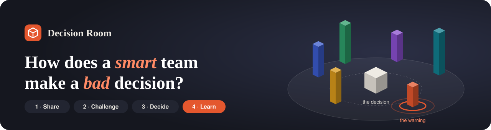
</p>

<p align="center">
  <a href="https://app.netlify.com/start/deploy?repository=https://github.com/Hazem-NEFZI/decision-room"></a>
</p>

<p align="center">
  
  
  
  
  
</p>

<p align="center">
  <b>A team decision tool built on one question from our management presentation:</b><br>
  <i>How does a smart team make a bad decision?</i>
</p>

---

## 💡 The idea in 30 seconds

Smart teams rarely fail because people lack intelligence. They fail because of **what the team does with what each person knows**.

In 1985, Coca-Cola ran about **200,000 taste tests**. The new formula won, so it replaced the original. About **1 in 10** testers had reacted angrily to the idea, but that signal never shaped the decision. **79 days later**, the original came back.

Research points the same way. In Woolley et al. (2010), what predicted a group's performance was **evenly shared speaking turns** (r = .41) and **social sensitivity** (r = .26), more than the IQ of its smartest member (r = .19).

**Decision Room turns that lesson into a process every team can run.**

<p align="center">
  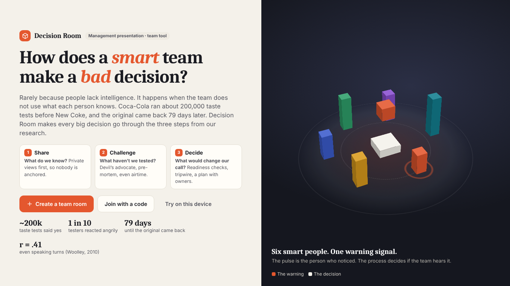
</p>

---

## 🔁 How it works

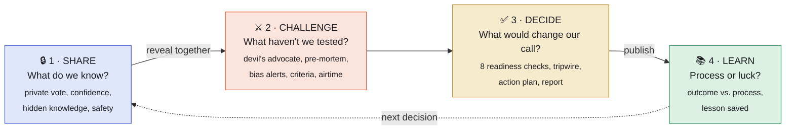

| Step | The trap it prevents | What the tool does |
|---|---|---|
| **1 · Share** | Anchoring, deferring to the boss, hidden knowledge | Everyone answers **privately** before any discussion. Votes stay sealed until the manager reveals them all at once. |
| **2 · Challenge** | Groupthink, confirmation bias, overconfidence | Devil's advocate, pre-mortem, automatic **mind-trap alerts**, assumptions & risk matrix, weighted criteria, airtime tracker. |
| **3 · Decide** | Committing without a way back | **8 readiness checks**, a tripwire, a plan with owners and dates, a one-click report. |
| **4 · Learn** | Judging by results only | Separates **process** from **outcome**: earned success, bad luck, lucky outcome or avoidable failure. |

---

## 📸 Screenshots

<table>
  <tr>
    <td width="50%">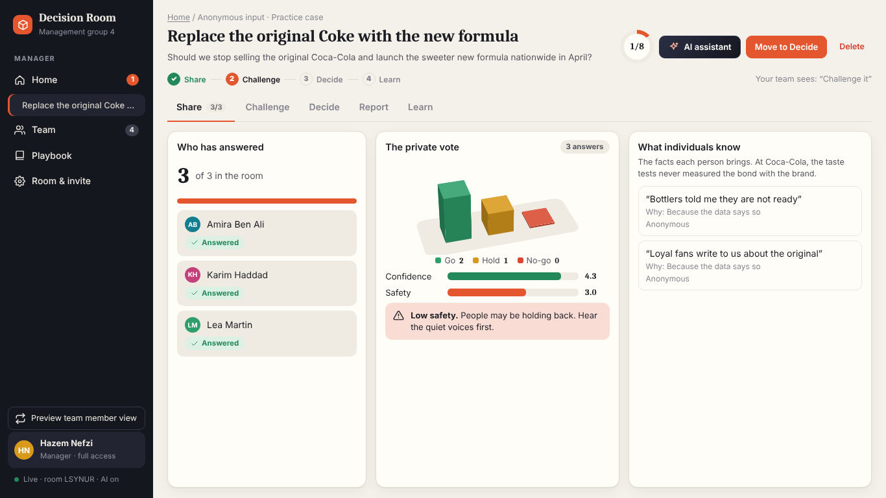<br><b>Share.</b> Sealed private votes, revealed in 3D, with confidence and psychological safety.</td>
    <td width="50%">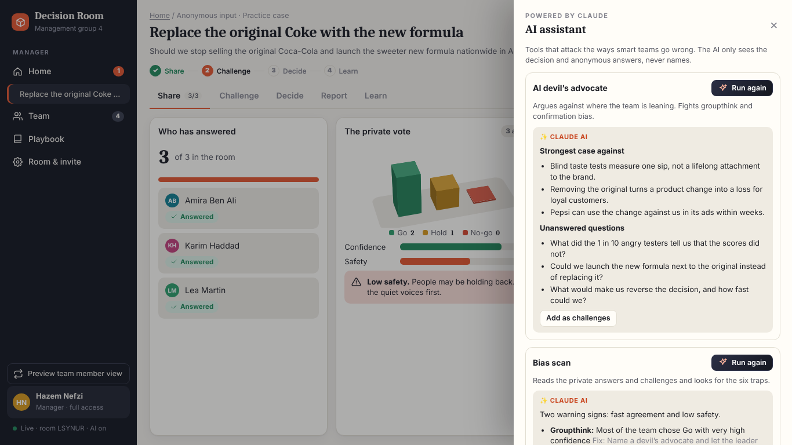<br><b>AI assistant.</b> Devil's advocate, bias scan, assumptions, plan and summary.</td>
  </tr>
  <tr>
    <td>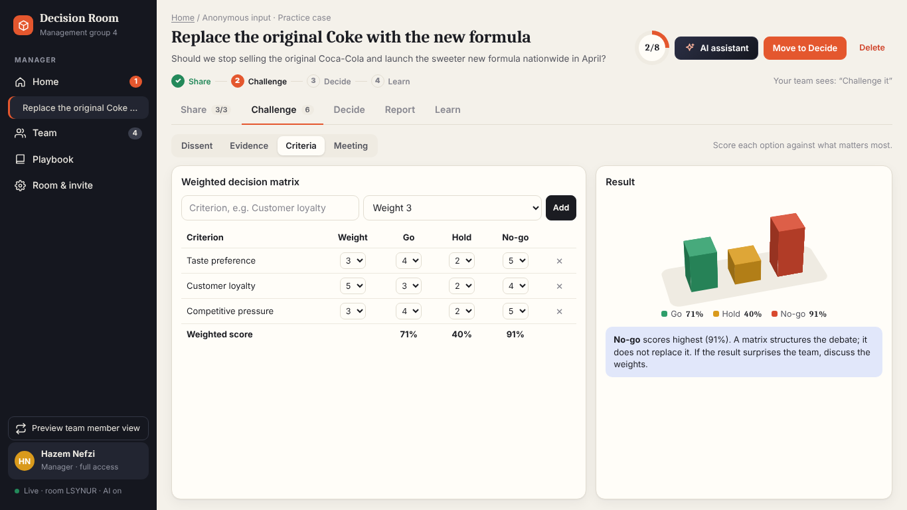<br><b>Challenge.</b> Weighted decision matrix with 3D results.</td>
    <td>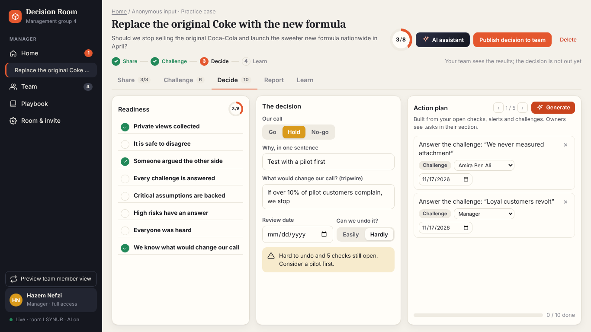<br><b>Decide.</b> Readiness checks, tripwire and a generated action plan.</td>
  </tr>
  <tr>
    <td>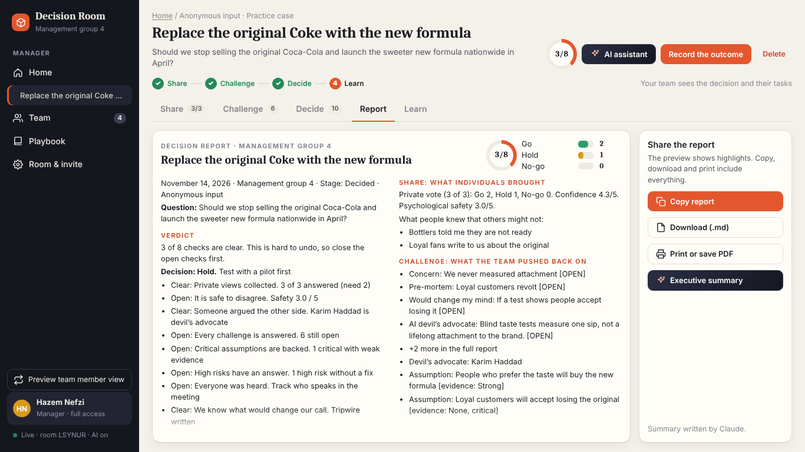<br><b>Report.</b> Copy, download or print to PDF.</td>
    <td>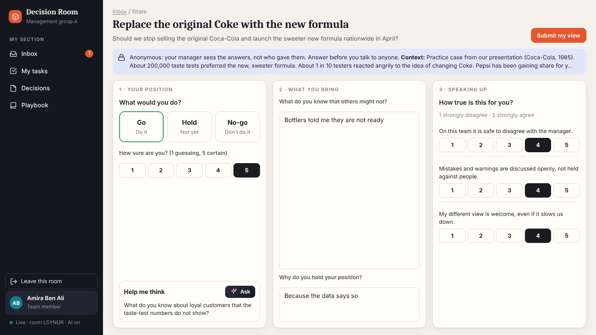<br><b>Team member section.</b> Private answers, with a "Help me think" AI coach.</td>
  </tr>
  <tr>
    <td colspan="2">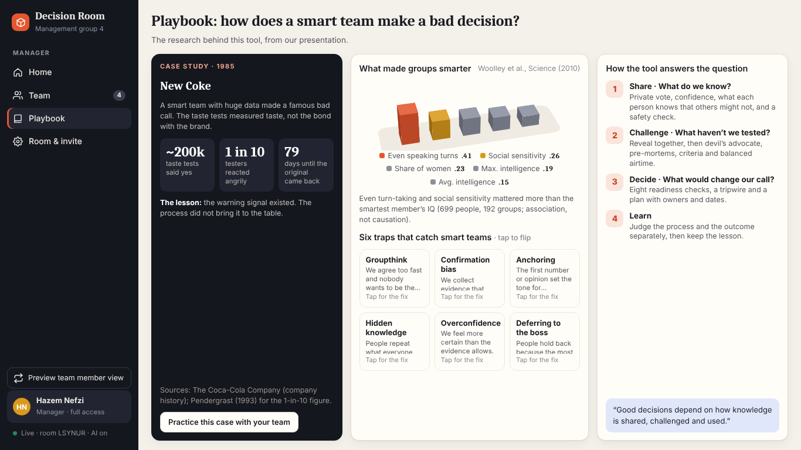<br><b>Playbook.</b> The New Coke case, the Woolley research in 3D and the six traps as flip cards.</td>
  </tr>
</table>

---

## 👥 Two sections: manager and team

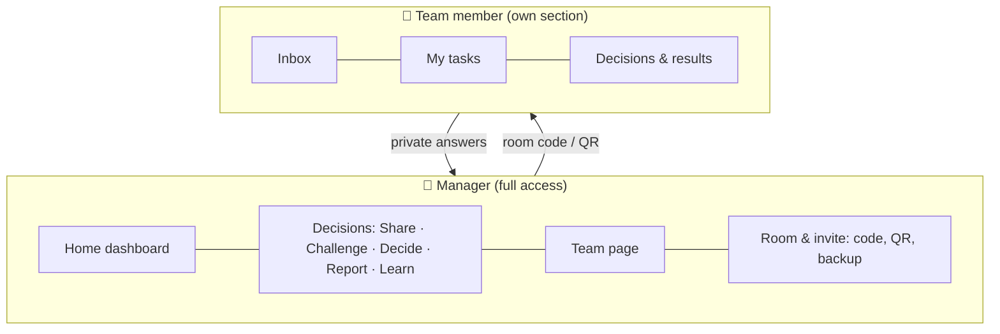

- **Manager:** creates a room, sees who has answered, reveals results, runs the Challenge tools, publishes the decision.
- **Team member:** joins with a **6-letter code**, no account. Answers privately, can be named devil's advocate, receives their tasks.
- **Anonymous mode:** the manager sees *what* was said, not *who* said it.

---

## 🤖 AI features

| Tool | What it does | Trap it targets |
|---|---|---|
| 😈 **Devil's advocate** | The 3 strongest arguments against where the team is leaning, plus 3 unanswered questions | Groupthink |
| 🔍 **Bias scan** | Reads the anonymous answers and flags the six traps, with evidence | All six |
| 🧩 **Hidden assumptions & risks** | Lists what must be true and what could go wrong | Overconfidence |
| 🗺️ **Plan draft** | Turns open gaps into concrete actions with dates | Weak follow-through |
| 📝 **Executive summary** | 3 sentences for your boss | — |
| 💭 **Help me think** *(team)* | One probing question before you vote | Anchoring |

> **No key? No problem.** Every AI button still works using built-in rules. The AI only ever receives the decision and anonymous answers, never names.

---

## 🚀 Deploy your own (about 5 minutes)

### Option A: one click
Press the **Deploy to Netlify** button at the top of this page.

### Option B: from GitHub
1. Fork or upload this repository to your GitHub.
2. Netlify → **Add new site → Import an existing project → GitHub** → pick the repo.
3. Leave the build settings as they are (they come from `netlify.toml`) → **Deploy**.
4. Optional: **Site configuration → Change site name**, e.g. `decision-room-group4`.

### Option C: Netlify CLI
```bash
npm install -g netlify-cli
netlify login
netlify deploy --prod
```

> ⚠️ **Netlify Drop** (drag-and-drop) publishes static files only. The site opens, but team rooms need the serverless function, so only "Try on this device" works.

### Turn on the AI (optional)

| Variable | Value | Required |
|---|---|---|
| `ANTHROPIC_API_KEY` | Your key from [console.anthropic.com](https://console.anthropic.com) | ✅ for AI |
| `AI_MODEL` | Defaults to `claude-sonnet-5-5` | optional |

Add them in **Site configuration → Environment variables**, then **Deploys → Trigger deploy**.
Each room is limited to **150 AI calls per day** (`AI_PER_DAY` in `api.mjs`). Usage is billed to your Anthropic account.

---

## 🧭 Using it

1. **Create a team room.** You get a room code, an invite link with QR, and a private manager link (keep it secret: it gives full access).
2. **Invite.** Teammates open the link or press **Join with a code** and type their name.
3. **New decision.** Pick a template (launch, pricing, hiring, investment, strategy) or the **New Coke practice case**.
4. **Reveal** once most people have answered. Then work through **Challenge → Decide → Publish**.
5. **Learn.** On the review date, record what happened and save the lesson.

> 🎓 **Class demo on one laptop:** choose **Try on this device**, switch to "Answer as a team member", and pass the laptop around.

---

## 🏗️ Architecture

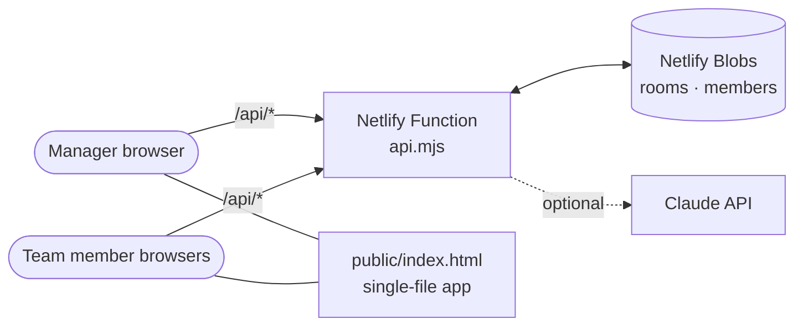

<details>
<summary><b>📁 Project files</b></summary>

```
decision-room/
├── public/
│   └── index.html            # the whole app: no build step, no framework
├── netlify/
│   └── functions/
│       └── api.mjs           # rooms, members, AI endpoint
├── docs/                     # README images
├── netlify.toml              # Netlify config
└── package.json              # @netlify/blobs dependency
```
</details>

<details>
<summary><b>🔌 API routes</b></summary>

| Method | Route | Who |
|---|---|---|
| `POST` | `/api/rooms` | anyone: creates a room and returns the code + manager key |
| `POST` | `/api/join` | anyone with a code: returns a member token |
| `GET` | `/api/room` | manager (all data) or member (public data + own answers) |
| `PUT` | `/api/room` | manager only |
| `PUT` | `/api/member` | the member themselves |
| `POST` | `/api/ai` | room members; needs `ANTHROPIC_API_KEY` |
| `GET` | `/api/health` | status + whether AI is on |
</details>

<details>
<summary><b>🔐 Privacy and security</b></summary>

- Room data lives in **your own Netlify account** (Netlify Blobs).
- Teammates can never read other people's answers. The manager sees answers, without names when a decision is anonymous.
- The manager key and member tokens are stored **hashed** (SHA-256) on the server.
- Anyone with the **manager link** has full access to that room, so keep it private.
</details>

---

## 📚 Research behind it

| Source | Used for |
|---|---|
| Woolley et al. (2010), *Science* 330:686–688 | Collective intelligence, even turn-taking, airtime tracker |
| Edmondson (1999) | Psychological safety questions |
| Janis (1972) | Groupthink, devil's advocate |
| Klein (2007) | Pre-mortem |
| Tversky & Kahneman (1974); Kahneman (2011) | Anchoring, confirmation bias, overconfidence |
| Stasser & Titus (1985) | Hidden knowledge (shared-information bias) |
| The Coca-Cola Company; Pendergrast (1993) | New Coke case |

<p align="center"><sub>Built for our management presentation · <b>"Good decisions depend on how knowledge is shared, challenged and used."</b></sub></p>
